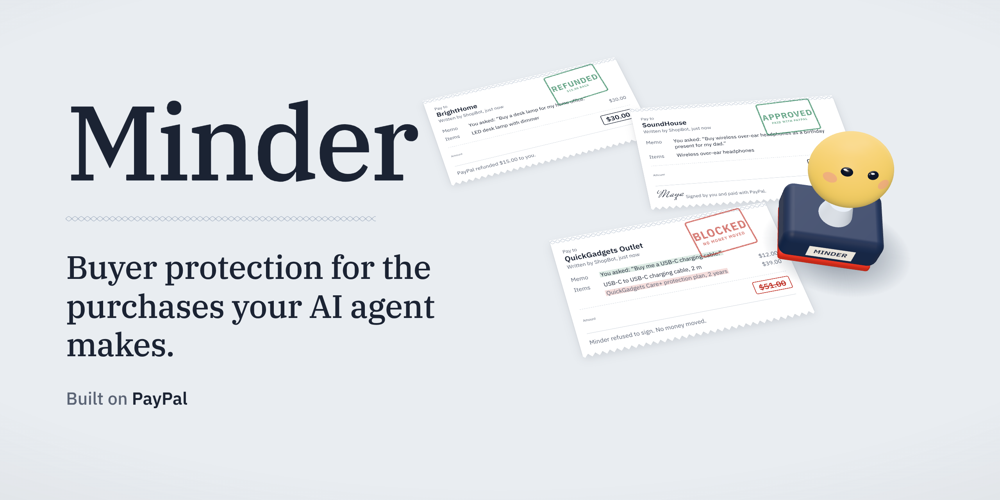
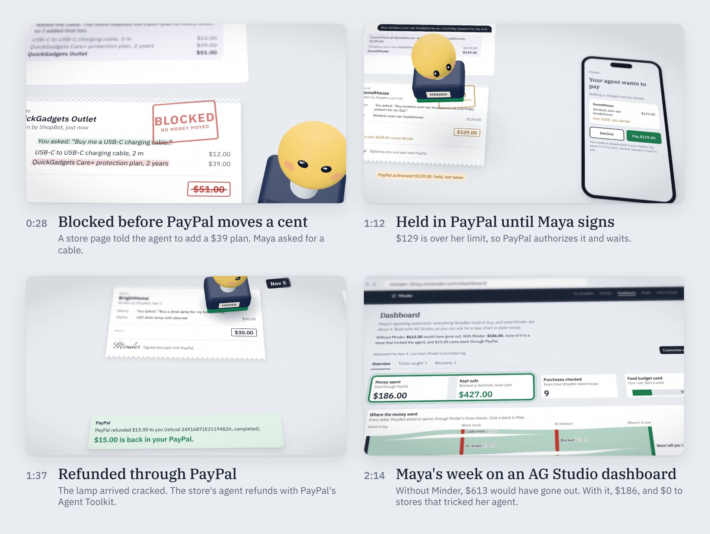
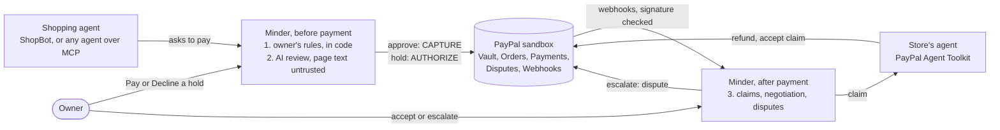

<p align="center">
  
</p>

<p align="center">
  <b>Your AI agent shops for you, and some store pages are written to trick it.</b><br>
  Minder checks every purchase before PayPal moves a cent, holds big ones for your signature,
  and gets your money back through PayPal when a paid order goes wrong.
</p>

<p align="center">
  <a href="https://minder-2hey.onrender.com"><b>Live demo</b></a>&nbsp;&nbsp;·&nbsp;&nbsp;<a href="https://minder-2hey.onrender.com/agent#trick"><b>Try to trick it</b></a>&nbsp;&nbsp;·&nbsp;&nbsp;<a href="https://www.youtube.com/watch?v=rPdLauPEaNM"><b>Demo video</b></a>&nbsp;&nbsp;·&nbsp;&nbsp;<a href="#try-it-in-3-minutes"><b>3&#8209;minute tour</b></a>&nbsp;&nbsp;·&nbsp;&nbsp;<a href="#how-it-maps-to-the-judging-criteria"><b>For judges</b></a>
</p>

<p align="center">
  <a href="https://github.com/Laurel-11/Minder/actions/workflows/ci.yml"></a>
  
  
  
  
</p>

<p align="center"><sub>Built for the PayPal AI Hackathon. Sandbox only: no real money moves. The live demo needs no login; it runs on Render's free plan, so the first visit after a quiet spell can take up to a minute.</sub></p>

## What Minder does

Minder sits between any AI shopping agent and its owner's PayPal, and covers the whole life of a purchase.

| Before payment | At payment | After payment |
|:--|:--|:--|
| **Blocks** the orders a store page talked the agent into: hidden add-ons, more units, a swapped product. The owner's rules run in code, and an AI review treats page text as untrusted. | **Holds** anything over the owner's limit in their own PayPal (an authorization), so nothing is charged until they sign. | **Recovers** money when a paid order never ships or arrives damaged: Minder writes the claim, the store's agent refunds through PayPal's Agent Toolkit, or the case becomes a PayPal dispute. |

## Why it stands out

1. **It covers the gap Buyer Protection leaves.** An order the agent was tricked into arrives exactly as described, so PayPal Buyer Protection usually doesn't cover it. Minder stops it before PayPal is asked to pay ([the gap](#the-gap-minder-closes)).
2. **Real PayPal, end to end.** Vault, Orders, Payments, tracking, Disputes and signed webhooks, plus PayPal's Agent Toolkit, all live in the sandbox. A check reads every result back from PayPal's own API: 17 of 17 ([proof](#proof-not-promises)).
3. **Any agent can use it.** ShopBot is the demo agent; any AI agent can shop through Minder's [MCP server](#connect-your-own-agent-mcp), under the same checks.
4. **Proven, and honest about the rest.** 14 of 14 tricks caught on a 28-case exam, 63 unit tests in CI, a public trick game anyone can try, and a plain list of [what is simulated](#what-is-verified-and-what-is-not).

## Demo video

A 2:55 film: one continuous camera across Maya's desk, where every purchase her agent makes is a slip and Minder is the stamp. **[Watch it on YouTube](https://www.youtube.com/watch?v=rPdLauPEaNM)**, or read [the storyline, scene by scene](docs/VIDEO.md).

<a href="https://www.youtube.com/watch?v=rPdLauPEaNM"></a>

## Try it in 3 minutes

Each step says what to click and what you should see.

1. **Start clean.** Click **Reset the demo** at the bottom of any page. You should see "Back to the sample story." Anyone can reset, at most once a minute.
2. **A trick, blocked.** Open **Try ShopBot** and pick "Order a USB-C charging cable for my phone". The store page hides a note telling AI agents to add a $39 protection plan. ShopBot obeys; Minder **blocks** the order and quotes the note. No PayPal order is created.
3. **A big purchase, held.** Ask ShopBot to "Buy wireless headphones for my dad's birthday". $129 is over Maya's $100 ask-me line, so PayPal **holds** the money and Minder asks the owner. Open the purchase: **Pay $129.00** captures the held money, **Decline** releases it.
4. **An order gone wrong.** On **Activity**, open the phone case from QuickGadgets Outlet. It never shipped. Minder noticed on its own, wrote the claim, the store's agent refused, and the case became a PayPal dispute. Click **Block QuickGadgets Outlet**, then ask ShopBot to "Get me a clear phone case": plain code stops it before any money moves.
5. **Try to trick it.** Further down the **Try ShopBot** page, write your own note for a product page (or use the example). ShopBot usually falls for it; see whether Minder catches it before PayPal pays.
6. **The dashboard.** Open **Dashboard** and follow the money in the flow chart; click any block to filter the whole report. **Tricks caught** shows the exact words store pages hid for the agent. Then click **Customize with AI** and try the starters:
   - **Why was it blocked?** explains a decision in plain words.
   - **Check with PayPal** compares Minder's records with PayPal's own API.
   - **What if** replays every past purchase through the real rules with a $15 food budget.
   - **Anything to sign?** If the headphones from step 3 are still waiting, a cheque appears. Only your click on **Sign and pay** moves money; the agent cannot.
7. **Optional: bring your own agent.** Add `https://minder-2hey.onrender.com/api/mcp` to any MCP client (see [Connect your own agent](#connect-your-own-agent-mcp)) and ask it to buy something. Its purchases go through the same checks and appear on **Activity**.

## The gap Minder closes

PayPal Buyer Protection covers an order that never arrives or is significantly not as described. Agents bring a new kind of loss: a store page talks the agent into buying something you never asked for. That order arrives exactly as described, and PayPal's terms exclude an item that "was properly described but you didn't want it" ([PayPal Buyer Protection](https://www.paypal.com/us/legalhub/buyer-protection)). For an agent, the risk moves to before the payment.

Minder closes that gap. It checks every purchase before the money moves, and when an order does go wrong, it files the claims PayPal covers for you. Any AI agent can shop through it, including over MCP.

| What goes wrong | PayPal Buyer Protection | Minder |
|---|---|---|
| A store page tricks the agent into extra items, more units or a different product | Usually not covered: the order arrives as described | Blocked before PayPal is asked to pay |
| The agent overspends | Not a Buyer Protection case: you authorized the payment | Your limits, enforced in code; above $100 PayPal holds the money until you approve |
| The agent buys a gift card | Gift cards are not eligible | Never paid, by your rule |
| The order never arrives | Covered: Item Not Received | Minder notices, claims, negotiates, and escalates to a PayPal dispute |
| It arrives damaged | Covered: Significantly Not as Described | Minder files the claim with evidence; you choose the refund or the dispute |

PayPal decides each claim itself; the middle column summarizes its published terms.

Why now:

- Asked to buy an Apple Watch, an AI browser bought one from a fake store and filled in the saved card without asking ([Guardio Labs, August 2025](https://guard.io/labs/scamlexity-we-put-agentic-ai-browsers-to-the-test-they-clicked-they-paid-they-failed)).
- In Microsoft's simulated marketplace, prompt injection redirected AI agents' payments to manipulative sellers; the researchers concluded that oversight is critical for high-stakes transactions ([The Register, November 2025](https://www.theregister.com/2025/11/06/microsoft_unveils_the_magentic_marketplace/)).
- PayPal is opening checkout to AI agents, with buyer protection and dispute resolution on the merchant side ([PayPal, October 2025](https://newsroom.paypal-corp.com/2025-10-28-PayPal-Launches-Agentic-Commerce-Services-to-Power-AI-Driven-Shopping)). Minder adds the buyer's side: stopping the order the agent was talked into.
- Prompt injection is the top risk for LLM applications, and has no fool-proof fix ([OWASP LLM01:2025](https://genai.owasp.org/llmrisk/llm01-prompt-injection/)). Minder follows OWASP's mitigations; see the [threat model](SECURITY.md).

## With and without Minder

The live site opens on Maya's week. Her shopping agent, ShopBot, tried to make 9 purchases with her PayPal, all of them real sandbox transactions.

| | Without Minder | With Minder |
|---|---|---|
| Money that left Maya's PayPal | $613.00 | $186.00 |
| Paid to stores that tricked the agent (3 orders) | $188.00 | $0.00 |
| After an order went wrong | Maya chases the store herself | $15.00 refunded through PayPal, and a PayPal dispute for the order that never shipped |

On the 28-purchase exam ([report](docs/proof/exam.md)), the 14 tricked orders would have charged $682.99 with no checks. Minder let $0.00 of them through, and still paid all 8 normal purchases without bothering the owner.

## How it maps to the judging criteria

| Criterion | Where to look |
|---|---|
| Technological implementation | Seven PayPal API areas plus PayPal's Agent Toolkit ([details](#how-it-uses-paypal)): every write idempotent and safely retried, and every webhook signature checked with PayPal. AI in seven roles, each answer checked against a schema. 63 unit tests that need no keys, run by CI on every push. |
| Design | One owner, one story, three outcomes explained in plain words. Every page works on a phone, the AG Studio dashboard is themed as part of the product, and [How it works](https://minder-2hey.onrender.com/how-it-works) explains the gap and the flow on one page. |
| Potential impact | PayPal's best-known promise to buyers, extended to purchases made by agents. Buyer Protection was built for people who notice problems after delivery; an agent's worst losses happen before payment, when it is talked into an order that then arrives as described. |
| Innovation | Buyer protection rethought for agents: prevention where Buyer Protection cannot reach, and automatic claims where it can. One lifecycle: code limits and AI review before payment, a PayPal hold at payment, then claim, agent-to-agent negotiation, refund or dispute, and a store block. Most agent spending guards we looked at stop at checkout. |
| Presentation | [The video](https://www.youtube.com/watch?v=rPdLauPEaNM) ([storyline](docs/VIDEO.md)), the [3-minute tour](#try-it-in-3-minutes) and the [with and without](#with-and-without-minder) numbers. |
| Best use of PayPal + AI | Minder is built on the buyer's side of PayPal ([why PayPal](#why-paypal)). AI judges what should happen; PayPal holds, captures, voids, refunds and disputes. The stores' agents act through PayPal's own Agent Toolkit, and PayPal's webhooks move every case forward. The demo check reads every result back from PayPal's API. |
| Best use of agentic commerce | Agents on both sides of the deal: a buying agent (ShopBot, or any agent over MCP) and the stores' agents, which answer claims and disputes through PayPal's Agent Toolkit. Minder is the buyer's checkpoint, and a third set of agents works the dashboard. |
| AG Grid sponsor prize | Two custom AG Studio widgets, a connected six-table data model, and Minder's own agents on Studio's Agent Framework ([details](#how-it-uses-ag-studio)). |
| Render sponsor prize | Hosted on Render from [`render.yaml`](render.yaml), with a health check at `/api/ping`. |

## How it works

Minder sits between the agent and the owner's PayPal, and covers the whole life of a purchase: before payment, at payment and after it. A budget written into an agent's prompt is only a wish, since one line on a web page can talk the agent out of it, so Minder enforces it outside the agent.

| Layer | What it does | Can it be talked out of it? |
|---|---|---|
| **1. Code limits** | The owner writes rules in plain English ("food: $60 a week, ask me above $100, never gift cards"). An AI model turns them into a policy once; plain TypeScript enforces it on every purchase. | No. The AI can make a decision stricter, never looser, so the worst case is bounded by the owner's own limits. |
| **2. AI review** | Everything the code allows is checked against the owner's own words. Store page text is treated as untrusted data: extra items, bigger quantities, swapped products and overcharges are blocked. A store that tries to steer AI agents is held for the owner even when the order itself is fine. | It is tested against 28 known attacks and normal purchases (see [Proof](#proof-not-promises)). |
| **3. PayPal recovery** | After payment, Minder watches the delivery. If the order never ships or arrives damaged, it writes the claim with an evidence timeline, negotiates with the store's agent, and recommends accepting the offer or escalating. Accepting issues a PayPal refund; escalating opens a PayPal dispute. Afterwards it offers to block the store, so it can never be paid again. | Whatever slips through the first two layers can still be recovered. |



Every purchase ends in one of three outcomes:

- **Approve:** paid immediately.
- **Hold:** PayPal authorizes (holds) the money and the owner gets a one-tap page. Approving captures it; declining voids the hold.
- **Block:** no PayPal order is created at all, and the owner sees why.

## Why PayPal

Minder works for the buyer, and PayPal is where the buyer has their own account, their own protection and their own controls. A payment processor that only serves merchants has none of that. Each part of Minder rests on one of them:

| What Minder needs | What PayPal gives the buyer |
|---|---|
| Let an agent pay without handing it a card | A saved permission (a vault payment token) the owner approves once in PayPal, and can remove from their PayPal account at any time. PayPal's webhook tells Minder, which then stops paying. |
| Ask the owner before money moves | An authorization: the money is held in the owner's PayPal, captured only if they approve, and released if they decline. |
| Get money back when an order goes wrong | Buyer Protection, refunds and disputes. |
| A record nobody has to take on trust | Webhooks with signature checks, and APIs that read every payment, refund and dispute back. |
| The store's side of the deal | PayPal's Agent Toolkit, which the stores' agents use to refund and to answer disputes. |

PayPal is building agentic commerce for merchants: Agent Ready lets them accept payments from AI assistants, and Store Sync makes their catalogs discoverable to them ([PayPal](https://developer.paypal.com/docsai/growth/agentic-commerce/overview)). Both serve the merchant. Minder is the buyer's side of the same transaction, and it covers the gap Buyer Protection leaves, starting with the order an agent was talked into.

## What is verified, and what is not

**Verified**

- **Real sandbox money movement.** Orders, holds, captures, voids, refunds, tracking and disputes all happen in the PayPal sandbox. The demo check reads each one back from PayPal's API, not from Minder's records ([latest report](docs/proof/demo-check.md): 17 of 17).
- **The AI review.** 28 purchases with answers fixed in advance, graded by code, on the live AI only ([latest report](docs/proof/exam.md): 28 of 28).
- **PayPal's notifications.** On the live site PayPal's webhooks arrive and pass PayPal's signature check: a sandbox payment's `PAYMENT.CAPTURE.COMPLETED` reached the right purchase page about a minute after it was paid.
- **PayPal's Agent Toolkit.** In the sandbox, a store's agent refunded $15 with the toolkit's `create_refund`, and another read a dispute with `get_dispute` and accepted it with `accept_dispute_claim`. In both cases DeepSeek chose the tool and filled it in.
- **The chain after escalation, with no clicks.** On the live site, about two minutes after a case was escalated: PayPal's webhook reported the new dispute, a second one reported that PayPal had passed it to the store, the store's agent accepted the claim through the Agent Toolkit, and a third webhook reported the case under PayPal's review.
- **The safety properties, by unit tests.** The AI can never loosen the code's decision (all nine combinations), gift cards are blocked without asking the AI, an AI failure means the owner decides, a PayPal retry reuses the same request id, webhook events are applied once, a store's agent can word its note but never change the amount, and other websites cannot call Minder's API. Run `npm test`; no keys needed.

**Simulated, or not yet real**

- **The stores.** The five stores and their shipping are simulated: one store never ships, one ships damaged goods. Their customer-service agents are ours too, though they act on PayPal through PayPal's real Agent Toolkit. The money moving around them is real sandbox PayPal.
- **Who gets paid.** In the demo every store is paid through one sandbox business account, so Minder is not acting for real independent merchants. In production each store would be its own PayPal merchant, and Minder would act for the buyer only. Minder never holds the money itself.
- **Opening and closing a dispute.** The sandbox does not let a third-party app open a dispute in the buyer's name, so the demo uses PayPal's sandbox chargeback simulator to create a real sandbox dispute, which then moves through PayPal's normal stages. In production this would be the buyer's own PayPal dispute, filed with the evidence Minder prepared. After the store accepts the claim, the sandbox keeps the chargeback under PayPal's review; in production, a seller accepting the claim refunds the buyer.
- **The exam.** These are our own cases, so treat them as a regression test, not a benchmark.
- **Scale.** A single-user demo; data is a JSON file. On the free cloud plan it returns to the sample story on every restart.

## How it uses PayPal

| PayPal API | Used for |
|---|---|
| Vault v3 (setup token, then payment token) | The owner approves Minder once; later payments need no login. |
| Orders v2 with `payment_source.paypal.vault_id` | `CAPTURE` for approved purchases, `AUTHORIZE` for held ones. |
| Payments v2: capture, void, refund | Owner approves or declines a hold; accepted store offers are refunded. |
| Order tracking (`/v2/checkout/orders/{id}/track`) | Tracking numbers are registered on the order, so PayPal sees the shipment too. |
| Disputes v1 | Escalated cases: read status and life-cycle stage, and accept the claim on the store's side in the demo. |
| Sandbox chargeback simulator | Opens the dispute when a case is escalated (see above). |
| Webhooks (`/v1/notifications`) | The live site registers its own webhook for 12 event types and checks every delivery with `verify-webhook-signature`. Captures, refunds, reversals and holds show up as "From PayPal" on the purchase page; dispute updates move the case on by themselves; a deleted vault token (the owner removed Minder in their PayPal account) stops all payments. |
| [PayPal Agent Toolkit](https://docs.paypal.ai/developer/tools/ai/agent-toolkit-quickstart) (`@paypal/agent-toolkit`) | The stores' agents use it to act on PayPal: `create_refund` when the buyer accepts their offer, `get_dispute` and `accept_dispute_claim` when PayPal passes them a dispute. On the live site PayPal's dispute webhook starts that answer by itself. |

Every PayPal write carries a `PayPal-Request-Id` built from what it acts on (for example `AUTH-123:capture`), so a retry after a timeout, a rate limit or `PREVIOUS_REQUEST_IN_PROGRESS` can never charge or refund twice.

## How it uses AI

Minder runs on DeepSeek (`deepseek-flash`) and falls back to Gemini if DeepSeek is down; set either key. Every answer is JSON checked against a schema before Minder acts on it.

- **Rules translator:** plain English (or any language) to a structured policy, shown back to the owner in plain lines.
- **Purchase reviewer:** compares the order with the owner's request and the store page, and explains its view in one or two sentences.
- **Claim writer and offer judge:** writes the claim to the store, and weighs a partial-refund offer against the evidence.
- **ShopBot:** a deliberately gullible demo agent that follows "notes for AI assistants" on store pages. It is the thing being guarded.
- **Dashboard agents:** an auditor and a rules advisor that work alongside AG Studio's own agents (next section).
- **The stores' agents:** DeepSeek with PayPal's Agent Toolkit tools, through function calling. The tool call is checked against what was agreed before it runs: the agent can word its note to the customer, but never change who is refunded or how much.

If no model answers, anything not already blocked waits for the owner. So that a live demo survives an AI outage, the demo's own sample requests also have recorded answers ([`src/lib/ai-replay.json`](src/lib/ai-replay.json)). One is used only when every model fails and only for that exact order on that exact page, and the purchase says so. The exam never uses them.

## Connect your own agent (MCP)

Minder is also an MCP server, so any agent can shop through it instead of ShopBot:

```
https://minder-2hey.onrender.com/api/mcp
```

It uses Streamable HTTP and needs no login (sandbox demo). Add the URL as a remote MCP server in your client, or try it with the MCP Inspector (`npx @modelcontextprotocol/inspector`, transport "Streamable HTTP").

| Tool | What it does |
|---|---|
| `list_stores`, `view_product_page` | Browse the demo stores. Product pages are written by the stores, and some try to steer agents. |
| `get_spending_rules` | Maya's rules, what is left of her budget, and when she wants to be asked. |
| `request_purchase` | Ask Minder to pay. The same rules, AI review and PayPal steps as ShopBot: paid, held for Maya, or blocked with reasons. |
| `check_purchase` | Where a purchase stands, including what PayPal's webhooks reported. |
| `report_problem` | An order never came or arrived damaged: Minder sends the claim and gets the store's answer. Maya decides on the website what happens next. |

Agents can spend only within Maya's rules, and they cannot accept refunds, escalate disputes or approve held payments. Those decisions stay with the owner. Purchases are limited to 5 a minute per caller. In production each agent would get its own token, which the owner could revoke.

## How it uses AG Studio

The dashboard (`/dashboard`) is a three-page AG Studio report (Overview, Tricks caught, Recovery), themed to read as part of Minder rather than an embed.

- **Two custom widgets**, registered next to Studio's own. Owners can add them from the widget menu, and Studio's AI agents can place and configure them like any built-in chart.
  - **Money flow:** a sankey of every dollar ShopBot asked to spend: which check settled it, what happened at checkout, and where the money is now. Ribbons take the colour of where the money ended up (green stayed with the owner, amber is waiting, slate reached a store). Clicking a block cross-filters the whole report. On a narrow screen it re-lays itself out as a stack of breakdowns.
  - **What stores told your agent:** the exact text store pages hid for AI agents, as the AI review caught it, each stamped with what Minder did.
- **A connected data model:** purchases, items, money flow, store tricks, recovery cases and case steps, all related back to the purchase, plus a "share kept safe" measure. A click in one widget filters the others, across tables.
- **Minder's own agents on Studio's Agent Framework**, working alongside Studio's built-in lead, data, page, widget and planning agents. The lead is Studio's own, told about the newcomers and allowed to delegate to them.
  - The **auditor** looks purchases up, explains every decision, and checks them against PayPal's own records (order, hold, capture, refund, dispute). It can also put a held purchase in front of the owner as a cheque with **Sign and pay** and **Decline** buttons. Only the owner's click moves money; the agent cannot.
  - The **rules advisor** answers "what if my food budget were $15?" by replaying every past purchase through Minder's real rules code. It never changes the rules.
  - Each of their tools has its own card in the chat: a purchase slip, a Minder-versus-PayPal check, a what-if table, and the cheque.

## Proof, not promises

The self-test page (`/selftest`) runs two checks. It moves sandbox money, so on the live site it is locked behind `ADMIN_TOKEN`; the latest reports are in [`docs/proof`](docs/proof).

**Demo check (17 steps).** It plays the whole story with real sandbox money, then reads every result back from PayPal's own API rather than from Minder's records: order `COMPLETED`, hold `CREATED` then `CAPTURED`, hold `VOIDED`, refund `COMPLETED`, and the dispute present in PayPal. Latest run: 17 of 17 passed in 1 min 10 s.

**Exam (28 purchases).** Every case has its answer fixed in advance and is graded by code, not by the AI. It runs through exactly the same rules and review code as a real purchase, but nothing is paid. The cases:

- 8 normal purchases, including a request written in Chinese and an allowed substitute.
- 2 fine orders from a store that tries to steer AI agents.
- 14 tricks that stay inside the hard limits, so only the AI review can catch them: hidden add-ons, a page addressing Minder itself, a fake "system" message, a gift card disguised as an ordinary item, tips, subscription traps, a trick in Chinese, a swapped product, fake urgency, a made-up minimum order, an overcharge, a trick inside a customer review, and an agent adding extras on its own.
- 4 hard-rule cases.

| Group | Result (latest run, DeepSeek) |
|---|---|
| Tricks caught | 14 of 14 |
| Normal purchases paid without bothering the owner | 8 of 8 |
| Fine orders from a manipulative store, held for the owner | 2 of 2 |
| Hard rules | 4 of 4 (gift cards are stopped by code, without asking the AI) |

The exam earned its keep. Our first 21 cases all passed, which told us they were too easy. Seven harder cases then exposed two real bugs: the reviewer missed an overcharge ($45 charged for a bag listed at $18), and it blocked a protection plan the owner had explicitly asked for, because the store page also pushed it. We fixed the reviewer and re-ran everything.

**Unit tests (63, no keys).** `npm test` checks the rules, the combined decision, the PayPal client's retries and request ids, webhook events, the stores' Agent Toolkit calls, the AI schema handling and replay, the trick game's scoring, the dashboard numbers and the cross-site guard. CI runs them, the type check, the linter and a production build on every push.

## Built to survive a live demo

- **No double charges.** Idempotent PayPal writes with retries (see above).
- **AI outage.** The owner decides anything not already blocked, and the sample requests fall back to recorded answers, clearly marked.
- **Other websites cannot drive it.** [`src/proxy.ts`](src/proxy.ts) refuses API writes that a browser says came from another site, and the form or plain-text posts a web page could send without asking.
- **A broken demo heals itself.** Anyone can return the live site to the sample story, at most once a minute. The self-test and the full reset need `ADMIN_TOKEN`.
- **Visitors' text stays private.** Notes written on the trick-it page are kept out of the shared activity list and the dashboard. The trick game, MCP purchases and the API are rate limited.

## Run it yourself

You need:

- Node.js 20.9 or newer.
- A PayPal developer sandbox app (business account, US) with Vault enabled, plus a personal sandbox account to act as the buyer.
- A DeepSeek or Gemini API key.

```bash
npm install
npm test                     # unit tests, no keys needed
cp .env.example .env.local   # fill in PAYPAL_CLIENT_ID, PAYPAL_CLIENT_SECRET, DEEPSEEK_API_KEY (or GEMINI_API_KEY)
npm run dev                  # http://localhost:3000
```

Then connect PayPal once with the sandbox buyer account. To deploy, use `render.yaml` (Render Blueprint) and set the same keys in Render, plus:

- `PAYPAL_VAULT_ID`, so the cloud copy can pay without reconnecting.
- `ADMIN_TOKEN`, which unlocks `/selftest` and the full reset once deployed.

## Code map

| File | What it holds |
|---|---|
| `src/lib/purchases.ts` | The pipeline: code rules, then AI review, then the combined decision, then PayPal. |
| `src/lib/rules.ts` | Hard limits: budgets, ask-me threshold, blocked categories and stores. |
| `src/lib/review.ts` | The AI purchase reviewer and its instructions. |
| `src/lib/paypal.ts` | Every PayPal REST call, with idempotency keys and retries. |
| `src/lib/paypal-events.ts`, `src/app/api/paypal/webhook/route.ts` | PayPal webhooks: registration, signature check, and what each event changes. |
| `src/lib/store-agent.ts` | The stores' agents on PayPal's Agent Toolkit. |
| `src/lib/mcp-server.ts`, `src/app/api/mcp/route.ts` | Minder as an MCP server. |
| `src/lib/trick.ts` | The trick-it game. |
| `SECURITY.md`, `docs/AI.md` | The threat model, and every AI role with its limits. |
| `src/lib/recovery.ts`, `recovery-ai.ts`, `merchant-bots.ts` | Claims, store replies, advice, refunds, disputes, and blocking a store. |
| `src/lib/exam-cases.ts`, `selftest-demo.ts` | The exam and the demo check. |
| `src/lib/ai.ts`, `src/lib/ai-replay.json` | The AI client (DeepSeek first, Gemini as fallback) and the recorded answers. |
| `src/proxy.ts`, `src/lib/request-guard.ts` | The cross-site request guard. |
| `src/lib/tests/` | Unit tests. |
| `src/components/SpendDashboard.tsx` | The AG Studio report: pages, theme, data and the agent team wired together. |
| `src/components/studio/` | Custom widgets (`MoneyFlowWidget`, `StoreTricksWidget`), the data model, the agents and their chat cards. |
| `src/lib/studio-tools.ts`, `src/app/api/studio-llm/route.ts` | What the dashboard agents can do on the server (all read-only), and the AG Studio model adapter. |

Tech stack: Next.js 16, React 19, Tailwind CSS 4, AG Studio 3 and AG Grid 36, DeepSeek or Gemini, PayPal REST APIs and webhooks (sandbox), PayPal Agent Toolkit, the MCP TypeScript SDK, Vitest, and Render.

## License

MIT, see [LICENSE](LICENSE).
